# Reefq platform blueprint

Product specification, 25 October 2026. This document records the owner's expanded requirements; it does not claim these backend features exist. Current application behaviour stays unchanged. Implementation of accounts, commissions, payouts, storage and AI integrations requires a separate backend workstream under the repository's current rules.

## 1. Confirmed business requirements

- The owner delegates daily operations to one trusted agent, who is the operational **super admin**: partner onboarding, customer follow-up, design work, payment checks, template approval and payouts.
- Jewellery shops, wedding venues and other wedding businesses are private referral partners. Each has an account, referral link, printable QR code and agreed commission.
- The super admin negotiates partner terms within the owner's allowed commercial limits.
- A partner may give a customer a discount from that partner's own commission. The super admin may give a discount from the super admin's own commission. Neither discount reduces the owner's protected allocation.
- Commissions are earned on verified paid business, not clicks or unverified receipt uploads.
- The last eligible partner link wins. The exact attribution cutoff and expiry proposed below remain policy choices, not existing behaviour.
- Partners see their own referred customer/order progress, commission balances and payout requests. No partner-programme recruitment or commission information appears in the couple-facing product.
- Withdrawal becomes available when the available balance is **strictly greater than 200 TND**. Methods: cash, Mandat Minute or bank transfer using a RIB. Fees vary by amount/method and are shown before confirmation.
- Batch-print business cards/QR codes. The signed-in super admin scans a code, provisions the partner and sends account activation through SMS, WhatsApp or Messenger.
- Studio becomes a detailed invitation/template editor. Reuse approved personalised designs as future templates, after removing customer data.
- Plans differ in design/animation capabilities and service level; final prices and entitlements are configurable commercial decisions.

## 2. Roles and private workspaces

| Role | Main workspace | Access |
| --- | --- | --- |
| Owner | Business controls and reports | Sets the protected owner allocation, commercial limits and operational delegation; can review all records. |
| Trusted super admin | Studio | Runs daily operations, edits and approves designs, onboards partners, assigns allowed commissions, verifies payments and processes payouts. Can discount their own allocation. |
| Partner | Private partner portal | Only their assigned referral links, QR materials, permitted customer progress, own commission and own payout history. Can discount their own allocation within its cap. |
| Couple | Existing client space | Own invitation, payment, guest links and replies; no partner or agent balances. |
| Guest | Personal invitation | Their invitation and RSVP; no operational or commission data. |

“Super admin” means full daily operational control. To satisfy the owner's protected-share rule, changing that protected allocation or exceeding its commission pool remains an owner-controlled business action. Enforce this on the server/database, not just by hiding an input. Partners and the super admin never receive database service keys. Everyone uses a named account rather than the current shared Studio password.

Initially assign the sole super admin as the responsible agent on every order they handle, including partner-referred orders. Store that assignment on the order. Future reassignment must not silently move already-earned commission to another person.

## 3. Protected owner allocation and discounts

Define money per order before discounts:

```text
P  = agreed catalogue/base price
O  = protected owner allocation
C  = separately budgeted operating reserve, if configured
Bp = partner allocation before their voluntary discount
Ba = responsible agent allocation before their voluntary discount
Dp = customer discount funded by the partner
Da = customer discount funded by the agent

Require: O + C + Bp + Ba = P
Require: 0 <= Dp <= Bp; 0 <= Da <= Ba

Customer pays       = P - Dp - Da
Partner commission  = Bp - Dp
Agent commission    = Ba - Da
Owner allocation    = O
Operating reserve   = C
```

An illustrative 300 TND order, with no separate reserve:

| Allocation | Before discounts | Funds customer discount | Earned after full verified payment |
| --- | ---: | ---: | ---: |
| Owner | 180 TND | 0 TND | **180 TND** |
| Partner | 75 TND | 20 TND | 55 TND |
| Super admin / agent | 45 TND | 10 TND | 35 TND |
| Total | 300 TND | 30 TND | Customer pays **270 TND** |

These numbers explain the calculation; they do not set prices or agreed percentages. The owner may configure their allocation as a fixed amount or a percentage of the **undiscounted base price**, subject to a floor. Negotiating a larger partner commission must fit the remaining pool, including an explicitly approved reduction of the agent allocation if needed. It cannot consume the owner allocation or required reserve.

Use integer millimes, not floating-point money: 1 TND = 1,000 millimes. Store rates as integer basis points and define rounding centrally. Allocate any rounding residue consistently without reducing the protected floor. The owner allocation is a distribution rule, not a guarantee of net profit after all external expenses.

Each quote/order snapshots the plan version, price, owner policy, partner/agent assignments, commission rates/amounts and each discount sponsor. Later rate negotiations apply to future quotes. Changing an unpaid quote creates a visible replacement quote; changing a paid order creates an audited adjustment, never a rewrite of its original money record.

The server computes quotes. A browser-supplied price, commission, partner id or balance is never authoritative. AI may suggest design changes but cannot set commercial rates or approve a payment/payout.

## 4. Attribution: private programme, last eligible link

Recommended policy to confirm before implementation:

1. A public `/r/<opaque-code>` resolves an active partner code and records an eligible referral touch. Recommend a configurable 30-day attribution window to start.
2. A later valid partner click replaces the earlier eligible click. Direct visits, invalid/revoked codes and ordinary invitation footer links do not overwrite it.
3. At checkout, the latest eligible touch becomes the order attribution and terms are snapshotted. An existing unpaid order can be explicitly requoted for a different partner; a later click must not secretly alter a bank-transfer amount or an already-paid allocation.
4. A repeated visit through the same code does not create a second order or commission. Do not fingerprint people to guess cross-device identity.
5. Keep the existing customer/friend referral programme separate from business partners. Its `?ref=RQ-XXXXX` field is not a partner account or partner ledger. Define discount stacking explicitly; proposed default is one commercial offer per quote.

The couple sees the applicable final price/discount and invitation, without a programme banner, partner earnings, recruitment link or access to partner APIs. Partners receive only the minimum permitted order progress: reference, agreed customer display name, plan/status, payment eligibility and their own commission. Guest lists, client-link secrets, receipts, RIB data and other partners' activity are excluded.

Server-authorised, scoped real-time events update the portal after committed changes. Reconnecting reloads a current snapshot so missed events do not change the balance calculation.

## 5. QR cards and partner activation

```mermaid
flowchart LR
  A[Generate batch of public referral codes] --> B[Print QR business cards]
  B --> C[Signed-in super admin scans a card]
  C --> D[Claim code and create partner]
  D --> E[Assign allowed commission and details]
  E --> F[Send one-time account activation]
  F --> G[Partner activates own account]
  G --> H[Customers scan same public referral QR]
  H --> I[Invitation catalogue with referral attribution]
```



Batch codes have `unassigned`, `assigned`, `active` and `revoked` states, a batch id, print history and audit entries. Claiming a code is atomic: two scans cannot assign it to two accounts. Only an authenticated authorised operator can claim/manage a code. A customer scanning an unassigned card sees a normal landing page; it does not become an open partner-registration route.

**Public referral QR and private account activation are separate.** Printed QR codes contain a stable short referral URL, never a password or login token. Provision a generated account identifier and send an expiring, one-use activation link/code; the partner sets their own password or verifies an OTP. Do not keep or repeatedly send a permanent plaintext password.

First release can let the super admin explicitly send a prepared activation message in their chosen channel. Automatic SMS/WhatsApp/Messenger delivery is a later provider integration with its own credentials, permissions and delivery receipts. No messages have been sent as part of this specification.

Provide PDF sheets, individual SVG/PNG QR exports, business-card layouts, print-safe margins and a scan-tested quiet zone. Use the actual Reefq address; allow future URL redirects without reprinting every card.

## 6. Payment, commissions and withdrawals

Keep payments, commission entries and payouts as separate records.

```text
Order created -> estimated commission (not spendable)
Verified receipts cover the final order amount -> earned commission
Earned commission -> available (or a clearly configured hold)
Payout requested -> reserve its amount atomically
Approved -> processing -> paid, with evidence/reference
Rejected/cancelled before payment -> release its reservation
Refund/correction -> linked reversal/adjustment entry
```

Important current-code gap: `/api/orders/:code/status` can mark an order `paid` using the amount received/deposit. The new commission system must compare verified receipts with the final quoted total; it must not assume the existing `paid` label alone establishes full settlement.

- Credit each beneficiary once per eligible order/payment event, using a unique idempotency key and a database transaction. Duplicate admin clicks, webhook retries or reconnects must not duplicate earnings.
- Default to one responsible agent allocation per order; edits of their assignment/rate cannot create a second earning entry.
- Keep an append-only ledger with original entries, reversals, payout reservations and settlements. Do not let any portal directly overwrite a wallet balance.
- Pending quotes and submitted receipts are not withdrawable. Available balance excludes already-reserved amounts.
- Eligibility is `available_millimes > 200000`: exactly 200.000 TND is not enough; 200.001 TND passes the balance gate. Suggested initial UI requests the available amount; partial withdrawals need an explicit policy before implementation.
- Quote method, gross withdrawal, fees and net amount before confirmation; freeze the accepted fee schedule/version. Fees are borne by the withdrawing beneficiary, never silently deducted from the owner's allocation.
- Fee rules may be fixed, percentage-based or amount slabs per method, with minimum/maximum and effective dates. These are Reefq's agreed rules; external provider charges are a separate cost and must be identified clearly.
- Collect only the required payout information for cash, Mandat Minute or RIB; keep it private and mask it in lists. Record a cash acknowledgement, postal reference or bank reference as applicable.
- Admin approval is not proof that cash/bank/postal funds were delivered. Mark `paid` only when the operator records the actual completed payment and evidence. A crashed/uncertain transfer stays under reconciliation rather than being automatically retried as a second transfer.
- Refunds before payout reverse the relevant earnings. Refunds after payout require an explicit recovery/negative-balance policy; retain the original paid entries and make the adjustment traceable.

The trusted super admin can handle the operational queues, including their own payout under the configured policy; they cannot mint an extra balance, remove audit history or edit the protected owner policy. The owner may enable second approval for selected amounts, but daily owner approval is not assumed.

## 7. Studio: detailed, reusable editor

Build a template/document editor with a versioned data format, rather than a new hard-coded HTML page for every wedding.

| Area | Tools / settings |
| --- | --- |
| Document | Duplicate approved template, create draft, name/tags, plan eligibility, version history, compare, restore, publish/unpublish, preview URL. |
| Canvas | Mobile-first canvas, desktop/tablet preview, zoom, safe areas, guides, snap, align/distribute, grouped layers, duplicate, lock/hide, undo/redo, keyboard shortcuts. |
| Typography | Approved/uploaded licensed font families, supported Arabic glyphs, weights, size, line height, letter spacing where appropriate, colour, alignment, RTL direction and per-language styles. |
| Content | Bind names, families, openings, dates, venue, programme, closing, story and guest greeting to canonical invitation fields; preview each language and long names. |
| Appearance | Background image/video/colour/gradient, ornaments, borders, shadows, corner shapes, theme tokens and responsive constraints. |
| Motion | Editable scene sequence, clip replacement, trims, speed, fit/crop, transition choice/duration/easing, entrance/exit timings and reduced-motion poster/content behaviour. |
| Sound | Preserve original supplied soundtracks; clip volume/mute/fades as an explicit editor setting; manual guest activation for audible playback and muted automatic previews. |
| Media | Uploads, thumbnails, duration/resolution/audio metadata, private originals, optimised derivatives, poster selection, replace-with-preview and usage references. |
| Preview | Closed/open state, personal guest greeting, reserved seats, FR/AR/EN, reduced motion, narrow phones and validation before publishing. |
| Components | Reusable names, family wording, verse/opening, programme, map, countdown, RSVP and footer components with stable field contracts. |

“Every tool” is delivered in these groups, in phases; do not put controls on screen before their save/render behaviour exists. Couple accounts get only the controls allowed by their plan; the super admin gets the complete operational editor.

### What an MP4 can and cannot edit

The supplied Lovable exports are flattened media. Reefq can trim, replace, scale, crop, change playback timing/volume and place editable content over them. Their baked-in text, objects, lighting and internal animation are not recoverable editable layers. To change those, retain the source project/layered assets or generate a new clip. Keep couple-specific text and Arabic wording out of generated video whenever possible so a name change is an immediate data edit.

### Template lifecycle and reuse

```text
Approved template version -> duplicate -> couple-specific document
Custom design -> review -> remove personal content -> new draft template
New draft template -> super-admin approval -> immutable published version
Published version -> reused by future orders without another AI generation
```

Store `source_template_id`, `source_template_version`, the editable document and validated overrides. Publishing v2 does not change v1 invitations already shared with guests. Media references point to immutable versions; replacing an asset creates a version rather than overwriting a URL in use. An admin can explicitly migrate a couple's document with preview and rollback.

Reuse approval strips names, contact details, dates, venues where private, guest data, personal links, receipts and private uploads; review rights to any commissioned/customer-supplied assets. Publishing never automatically republishes a client's personal wedding site as a public template.

Keep wording grammar, Quranic/opening source strings, name order, RSVP and Maps bindings in the existing trusted renderer. AI/editor layout changes cannot redefine those behaviours. Upload/import validation checks allowed components and style properties; arbitrary generated scripts do not execute in the payment/admin origin. Unsupported custom code stays isolated for developer review.

## 8. Recommended architecture

Recommendation for this expanded scope: **Netlify frontend/API boundary + Supabase Postgres/Auth/Storage/Realtime + background jobs for heavy media/AI work**.

Supabase is now justified by named accounts, partner isolation, relational reporting and atomic monetary updates; this is different from the previous single-operator Blobs use case. It is still a planned migration, not a change made here.

| Domain | Proposed records |
| --- | --- |
| Identity | profiles, role assignments, partner accounts, responsible-agent assignments, activation invitations |
| Commercial terms | plan versions/entitlements, owner policies, partner/agent agreements, fee schedule versions |
| Attribution | QR batches, referral codes, referral touches, order attribution snapshots |
| Orders | orders, quote versions, verified payment records, private receipt references |
| Money | commission ledger entries, payout requests, reservation/settlement records, adjustments |
| Editor | templates, immutable template versions, invitation documents, document versions |
| Media/AI | source assets, derivatives, font metadata, generation jobs, prompts/provenance, cost records |
| Operations | audit events, notification outbox, delivery attempts, exception queues |

Use row policies and restricted views per role, private real-time channels and private storage for activation/payout/receipt data. Published invitation media can have a different distribution policy. Put money mutations behind server-side transactional operations with idempotency and immutable snapshots. Outbox delivery occurs after commit so a failed message cannot duplicate a commission.

Migrate through staging and backups, preserving order/invitation ids and guest links. Explicitly convert existing whole-TND amounts into millimes once, with recorded currency/unit metadata. Validate reconciled totals before cutover. Do not run two independent live balance writers in Blobs and Postgres. Keep an audited rollback plan and test a restored backup.

AI and media generation run in a queue with status/progress, per-order/workspace budgets, retries and review. Store finished output in Reefq-owned storage; a provider preview/download URL is not the permanent invitation asset.

## 9. Lovable, Gemini and costs

Recommendation: use Lovable to help author distinctive designs; use Reefq's own editor and approved template library for routine personalisation. Add a provider adapter for AI-assisted draft changes/assets later. Avoid paying to regenerate a complete website or video for every order, and never generate when each guest opens a link.

Verified provider facts on 25 October 2026 (prices may change):

- [Lovable REST API](https://docs.lovable.dev/integrations/lovable-api) currently documents workspace/project management, deployment, security and built-preview embedding. The embedded preview is not an embedded editor. [Lovable MCP](https://docs.lovable.dev/integrations/lovable-mcp-server) supports agent-driven project creation/editing. Treat these as separate integrations, not proof of a ready-made white-label Studio editor.
- [Lovable Git sync](https://docs.lovable.dev/integrations/github) supports keeping project code in a repository for review and external deployment. Use an isolated branch/review process, not automatic changes to Reefq production.
- [Lovable video tools](https://docs.lovable.dev/features/ai-video) can generate/edit clips and use underlying media models. Save the chosen output into durable Reefq storage and retain the source/reference information.
- [Google pricing](https://ai.google.dev/gemini-api/docs/pricing): Gemini 3.1 Flash-Lite standard text input/output is $0.25/$1.50 per million tokens. Gemini Omni 1.1 Flash 720p video output is approximately $0.10/second, excluding input charges. A 10-second output is therefore about $1 of output cost; retries and input add to the budget. Text assistance and video generation are different cost categories.
- [Google's current video guide](https://ai.google.dev/gemini-api/docs/video) says the Veo 3.1 preview endpoints shut down on 22 October 2026. Use the currently supported generation adapter/model; do not hard-code a retired preview based on an older tutorial. Provider accounts can expose different model availability.
- [Supabase pricing](https://supabase.com/pricing): Pro starts at $25/month; production traffic, storage/egress, messaging and AI remain additional budget items. Netlify usage is a separate bill. This is a baseline, not a quote for the full platform.
- [La Poste Tunisienne tariffs](https://www.poste.tn/nos_tarifs.php?code=3) publish amount-based Mandat Minute charges. Keep Reefq's fee schedule configurable and verify the applicable current tariff/provider arrangement before enabling that payout method; do not hard-code a universal fee from this specification.

These prices do not establish that one provider is universally cheapest. Benchmark a small set of the actual invitation requests and measure accepted-output cost, retries, latency and human editing time. Approved template reuse is the main structural saving.

## 10. Plans and delegated operations

Proposed differentiation, subject to owner pricing approval:

| Tier | Design capability | Routine delivery |
| --- | --- | --- |
| Essential | Approved static/light-motion templates and limited styling | Clone approved version; fill details; preview; verify payment; share. |
| Signature | Cinematic openings, richer transitions and more styling choices | Reuse approved media/template; personalise data; verify on mobile. |
| Prestige / custom | New art direction, custom motion/assets and deeper editor service | Super admin/designer prepares draft; approves; publishes; may sanitise it for later template reuse. |

Do not remove existing features or alter prices/entitlements for paid customers. Snapshot plan versions on new orders and honour existing orders while introducing the new tiers.

The super admin's home screen should be an exception queue: new partner/card claims, unanswered customer requests, receipts to verify, designs awaiting approval, failed jobs, available payout requests and reconciliation issues. The owner receives a concise financial/exception report; the super admin handles routine work.

The business can be delegated, but it is not maintenance-free: provider billing/model changes, backups, restore checks, account recovery, asset rights and exceptions still need an assigned operator.

## 11. Build order and acceptance gates

| Phase | Deliverable | Acceptance |
| --- | --- | --- |
| 0 | Finalise protected-share/attribution/payout policy and source-asset access | Example orders reconcile; agreed role boundaries and policy versions are recorded. |
| 1 | Named owner/super-admin/partner accounts, permissions and audit | Partners cannot query other accounts; no shared admin password; owner policy cannot be reduced by discount APIs. |
| 2 | Versioned plans, quotes, attribution, verified payments and commission ledger | Last-link cases, duplicate confirmation, partial payment, discount caps, refunds and rate changes reconcile exactly. |
| 3 | QR provisioning and partner portal | Batch claim races are safe; public QR never logs someone in; permitted order progress updates after commit. |
| 4 | Withdrawal ledger and manual cash/post/bank workflow | Strict >200 threshold, fee quote, reservation races, failed transfers and evidence are tested; no double payout. |
| 5 | Editor document format, uploads, fonts, preview and immutable templates | The five current designs are editable within the documented media limits; draft/publish/restore works across FR/AR/EN. |
| 6 | AI-assisted drafts and custom-design reuse | Budgets/retries are bounded; approval is required; no private customer content reaches public templates. |
| Release | Migrated staging candidate and owner-reviewed deployment | Existing guest links/RSVP/payment flows survive; normal-motion end-to-end checks pass; restore and role-isolation checks pass. |

Essential negative cases: two payout tabs competing for one balance; partner A then B; invalid/refused code after a valid referral; late clicks after a frozen quote; a 200.000 vs 200.001 TND balance; agent/partner discounts beyond their budget; changed rates after payment; duplicate payment/payout delivery callbacks; refunded paid-out commission; revoked partner sessions/real-time subscriptions; interrupted AI generation; and template updates after an invitation has been shared.

## 12. Decisions still to set before backend implementation

- Actual owner allocation/floor and operating reserve for each plan, and whether agent/partner rates vary by plan or order.
- Attribution window/cutoff and policy for explicitly requoting existing unpaid orders.
- Partial withdrawal rules, fee schedules, refund recovery and any availability hold.
- Required partner customer fields, activation channel/provider and payout evidence.
- Lovable/source-project access, font/asset licensing, and whether the first editor release supports only validated structured templates or also isolated custom-code designs.

All remain configurable design choices; no default values here silently change the live product. The protected owner share, agent-as-super-admin role and each party funding only their own discount are confirmed requirements.
