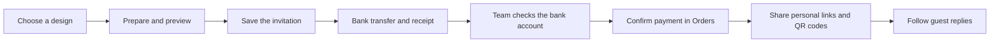

# Reefq working workflow

Use this page to pick the next task, review a change and hand it over. Business details remain in [OPERATIONS.md](OPERATIONS.md); technical setup is in [the README](../README.md).

The expanded editor, super-admin delegation, private partner programme and protected-share commission system are specified in [PLATFORM_BLUEPRINT.md](PLATFORM_BLUEPRINT.md). That is proposed backend scope, separate from the currently implemented visual workflow below.

Use [PRODUCT_PLAN.md](PRODUCT_PLAN.md) to select the next bounded improvement and its acceptance check. It separates current UI delivery from platform features that still need implementation.

## The customer journey



| Stage | Person | Where | What finishes the stage |
| --- | --- | --- | --- |
| Choose | Couple | Landing | An offer and design are selected on the order form. |
| Prepare | Couple | Client space | Names, families, event, style, text and guests are saved; the preview is reviewed. The new section links jump within this same form. |
| Transfer | Couple | Client space | A transfer uses the order reference and its receipt is uploaded. |
| Verify | Reefq team | Studio → Orders | The actual bank account is checked and payment is confirmed or a reason is given for rejection. |
| Share | Couple / team | Client space or Studio → Deliver | Guests receive their own links or QR codes. |
| Follow up | Couple / team | Client space / Guests & RSVPs | Replies and seat counts are reviewed; an export can be downloaded. |

For custom Canva sites, the designer must also publish the design before its guest page is available. Payment confirmation alone does not finish an unpublished custom design. Keep the printed Quranic-card preservation note when preparing QR cards.

The Studio design form is organised as **Details → Words → Design → Replies**. These are navigation links within the existing form, not a new saving process. Existing save, auto-save, conflict and guest-link behaviour stays in place.

## One task, one reviewable change

1. Start on a feature branch. Read `git status` and retain any existing work. Never develop or push directly on `main`.
2. State the visible outcome, the screens involved and the expected check. For example: “At 360 px, a couple can jump from the family fields to the invitation text without losing their inputs.”
3. Keep visual work in the files allowed by [AGENTS.md](../AGENTS.md). Business logic, APIs, uploads, persistence and migrations go to the owner/backend implementer.
4. Review the relevant screens in French and in Arabic at 360 px. Keep every existing input, submit button, hook and Arabic source string intact.
5. Run the review command below. Read the report and attach the relevant screenshots to the handoff.
6. Leave a clear list of what changed, what passed, what is blocked and what the next owner must do. A successful visual review is not a production release approval.

## The repeatable review command

From the project root:

```sh
node tools/ui-review.mjs
```

This runs `npm run guard`, `npm test`, and the opening catalog's filename, file-existence and size checks. It writes logs and `report.json` under the ignored `tools/promo/out/ui-review/` folder. A failed check makes the command exit unsuccessfully. The guard and tests are never edited or bypassed by the tool.

With `npm run dev` running locally in another terminal:

```sh
node tools/ui-review.mjs --url http://localhost:8888 --screenshots
```

This also checks the landing in FR / AR / EN at 360, 768 and 1440 px; opens the full theme gallery; and checks each cinematic invitation and RSVP in Arabic at 360 px. Browser review uses reduced motion for repeatable screenshots and makes no orders or saves. It checks page errors and document overflow; it does not establish Safari compatibility, contrast compliance, content accuracy or backend correctness. The report labels the full end-to-end suite `not_run` unless explicitly requested.

To run the unchanged full suite against **local** application data:

```sh
node tools/ui-review.mjs --url http://localhost:8888 --e2e
```

The tool accepts loopback HTTP origins only. `--e2e` runs `npm run test:e2e` with the selected local origin, and the existing test password/configuration applies. The suite creates local orders, receipt uploads and replies. The tool never deploys; the browser-only review creates no application records. Use `node tools/ui-review.mjs --help` for the options.

## Current review status

| Check | State | Next action |
| --- | --- | --- |
| Visual guard and unit suites | Passed in the opening-design work | Run again for every completed change. |
| Arabic at 360 px; landing at desktop/tablet widths | Passed for the five new collections | Review the screenshots after changing layout or copy. |
| Natural film ending, skip, failed-video fallback and reduced motion | Previously checked in Chrome | Recheck after changing media or the player. |
| Editing and customisation suites | Passed with French browser locale and reduced motion | Their normal-motion opening waits still need owner review. |
| Default full end-to-end suite | Blocked by opening assumptions | The smoke test assumes a visible automatic demo and a completed opening within 10 seconds; editing/customisation waits use 8 seconds. Full cinematic sequences take longer, and the mobile demo now follows the main action. The owner must align these assertions with the supported user flow. Do not shorten the films, alter the guard, or claim the suite passes. |
| Cross-device release review | Outstanding | Owner verifies real phones, Safari, and the full default-motion journey before release. |

Detailed evidence for the opening collections is in [opening-collections.md](opening-collections.md). The supplemental reduced-motion run described there is a separate check and is not a replacement for the default end-to-end release gate.

## Priorities and ownership

| Priority | Work | Owner | Ready when |
| --- | --- | --- | --- |
| P0 | Align default-motion end-to-end checks with cinematic openings | Owner / backend-test implementer | The unchanged intended business journey passes on the release candidate. |
| P0 | Review client, Studio and invitations on actual mobile devices | Owner + visual implementer | Arabic content, opening, payment, sharing and replies are usable on the target phones. |
| P1 | Admin asset upload and publishing | Backend implementer | Authenticated upload, server-side media validation, draft/published state and a runtime catalog work end to end. |
| P1 | Connect the runtime catalog to the existing theme selectors | Backend implementer + visual implementer | A published design appears consistently, without changing ids of saved invitations. |
| Later | Supabase storage/data migration | Owner + backend implementer | Storage access, data mapping, backups, migration verification and rollback are reviewed while keeping existing ids and personal links. |
| Release | Netlify deployment | Owner | Required checks pass; a finished branch is reviewed and merged in the owner's deployment batch. |

The JSON at `public/assets/media/openings/catalog.json` is currently an inventory, not a live database. Admin uploads and Supabase are future implementation tasks; no placeholder controls imply they already work.

## Release handoff

Use this small template in a PR or handoff:

```text
Outcome:
Screens/files changed:
Guard + unit results:
Browser checks and screenshots:
Default end-to-end result:
Remaining blockers / owner:
Deployment: not deployed / owner-released version
```

The owner combines finished branches and merges to `main`, at most once a day under the repository's deployment rule. Every merge can trigger a production deploy and use Netlify credits. Keep environment variables and release settings out of visual changes. Do not deploy while default end-to-end failures remain unresolved.
